# 1. 「ページを開く」と、裏で何回やり取りしているか

> 所要時間: 読むのに 8 分、手を動かして 5 分
> ゴール: 1 ページを開いたときにサーバへ届く問い合わせを、3 つに分けて数えられる
> 前提: ブラウザで URL を開いたことがある。ターミナルでコマンドを 1 行実行できる

## 0. 一枚で

アドレスバーに入れる URL は 1 つでも、ブラウザはサーバに何度も問い合わせています。

| いつ | ブラウザがすること | この章の例での回数 |
|---|---|---|
| 最初 | URL が指す HTML を取りに行く | 1 回 |
| HTML を読んだあと | HTML に書いてあった部品（見た目の指定、画像、プログラム）を取りに行く | 3 回 |
| プログラムが動いたあと | プログラムが必要としたデータを取りに行く | 1 回 |

職場で「このページ、リクエストが多いね」と言われたら、この表の 2 行目と 3 行目の回数の話です。

## 1. まず動かす

この本のフォルダで、次のコマンドを実行します。

```sh
npm install
npx playwright install chromium
node examples/01-page-load.mjs
```

最初の 2 行は準備で、1 回だけ実行します。3 行目が、手元に小さなサーバを立て、画面を出さないブラウザでページを 1 つ開きます。

結果は次のとおりです。

<!-- output: page-load -->
```
アドレスバーに入れた URL は 1 つ。サーバに届いたリクエストは次のとおり。

最初の 1 回（HTML）
  GET /             → 200  text/html; charset=utf-8
HTML を読んだブラウザが、追加で取りに来たもの（届く順は毎回変わる）
  GET /app.js       → 200  text/javascript
  GET /cat.svg      → 200  image/svg+xml
  GET /style.css    → 200  text/css
JavaScript が動いてから、さらに取りに来たもの
  GET /api/message  → 200  application/json

合計 5 回
画面の文章: サーバから届いた文章です
```

URL は 1 つなのに、サーバには 5 回の問い合わせが届きました。

## 2. 1 行の読み方

出力の 1 行は、1 往復のやり取りを表しています。

ブラウザからサーバへの問い合わせを **リクエスト** と呼び、サーバからの返事をレスポンスと呼びます。

`GET /style.css → 200 text/css` という行は、矢印の左がリクエストで、右がレスポンスです。

| 部分 | 意味 |
|---|---|
| `GET` | 「これをください」という種類のリクエスト |
| `/style.css` | 欲しいものの場所 |
| `200` | サーバの答えの番号。200 は「成功した」 |
| `text/css` | 返したものの種類。これは見た目の指定（CSS） |

`200` のような番号はステータスコードと呼びます。4 章で、200 以外の番号が出てきます。

`text/css` は、レスポンスの本体とは別に付いてくる **ヘッダ** という欄に書かれています。

ヘッダは、荷物に貼る送り状のようなものです。本体が何であるか、どう扱ってほしいかを、名前と値の組で伝えます。リクエストにもレスポンスにも付きます。

## 3. なぜ 5 回になるのか

最初に届く HTML には、ページの文章と、ほかの部品の置き場所が書いてあります。

<!-- source: examples/01-page-load.mjs -->
```html
<head>
  <meta charset="utf-8">
  <title>はじめてのページ</title>
  <link rel="stylesheet" href="/style.css">
</head>
<body>
  <h1>こんにちは</h1>
  
  <p id="message">読み込み中…</p>
  <script src="/app.js"></script>
</body>
```

`href="/style.css"`、`src="/cat.svg"`、`src="/app.js"` の 3 か所が、部品の置き場所です。

ブラウザは HTML を読みながら、この 3 つを見つけてリクエストを送ります。これが 2 回目から 4 回目です。

5 回目は、HTML のどこにも書いてありません。`/app.js` の中のプログラムが、動いたあとで送ったリクエストです。

<!-- source: examples/01-page-load.mjs -->
```js
fetch('/api/message').then((r) => r.json()).then((d) => { document.querySelector('#message').textContent = d.text; });
```

`fetch('/api/message')` が、サーバにデータを取りに行く命令です。届いた文章で、画面の「読み込み中…」を書き換えています。

出力の最後の行が「サーバから届いた文章です」になっているのは、この書き換えが済んだからです。

この順番を図にすると、次のようになります。



ブラウザは、全部がそろうのを待たずに画面を描き始めます。この例でも、5 回目のレスポンスが届くまでは「読み込み中…」と表示されていました。

**ページが出来上がるまでの時間は、この往復をすべて終えるまでの時間です。** 2 章は往復を速くする工夫、4 章は往復を減らす工夫の話です。

## 4. 演習: 自分のブラウザで数える

<!-- exercise: ex-count -->

同じページを、ふだん使っているブラウザで開いて、リクエストを数えます。

1. `node examples/01-page-load.mjs --serve` を実行する。`http://localhost:数字` という URL が表示される。
2. ブラウザで新しいタブを開き、開発者ツールを開く（Chrome なら、Windows は F12、Mac は Option + Command + I）。
3. 開発者ツールの「Network（ネットワーク）」タブを選ぶ。
4. 1 で表示された URL を、アドレスバーに入れて開く。

Network タブに並んだ行を数えてください。1 行が 1 回のリクエストです。

<details>
<summary>答え</summary>

`localhost`（HTML）、`style.css`、`cat.svg`、`app.js`、`message` の 5 行が並びます。この章の出力の「合計 5 回」と同じです。

`favicon.ico` という行が増えて、6 行になることがあります。これは、タブに出す小さなアイコンをブラウザが自分で取りに行ったものです。HTML には書いていないので、この章の出力では数えていません。

行をクリックすると、「Headers（ヘッダー）」の欄に、2 節で説明したヘッダが名前と値の組で並んでいます。

確かめ終わったら、ターミナルで Ctrl + C を押してサーバを止めます。

</details>

## 5. 理解度チェック

<!-- quiz: count-requests -->
**問 1.** あるページの HTML に、`` が 10 個、`<link rel="stylesheet">` が 2 個、`<script src>` が 1 個あります。どれも別々の URL を指しています。プログラムは `fetch` を 3 回呼びます。このページを開くと、リクエストは何回届きますか。3 つに分けて答えてください。

<details>
<summary>答え</summary>

HTML が 1 回、HTML に書いてあった部品が 13 回（10 + 2 + 1）、プログラムが動いてからの取得が 3 回で、合計 17 回です。

この章の例（1 回 + 3 回 + 1 回）と同じ分け方です。

</details>

<!-- quiz: count-requests -->
**問 2.** 「HTML を見れば、そのページが送るリクエストは全部わかる」。これは正しいですか。

<details>
<summary>答え</summary>

正しくありません。この章の 5 回目（`/api/message`）は、HTML には書いてありませんでした。

プログラムが動いてから送るリクエストは、HTML を読んでも見つかりません。3 節の `fetch` の行で確かめられます。

</details>

→ 次の章: [2 章](02-http-versions.md)
